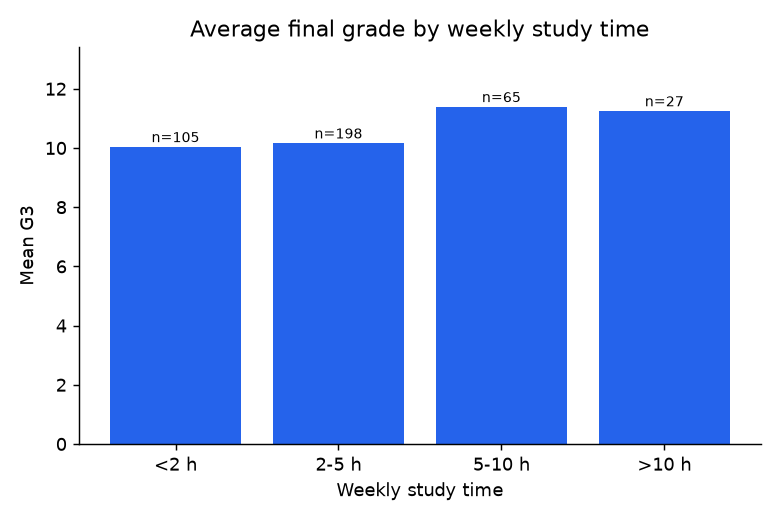
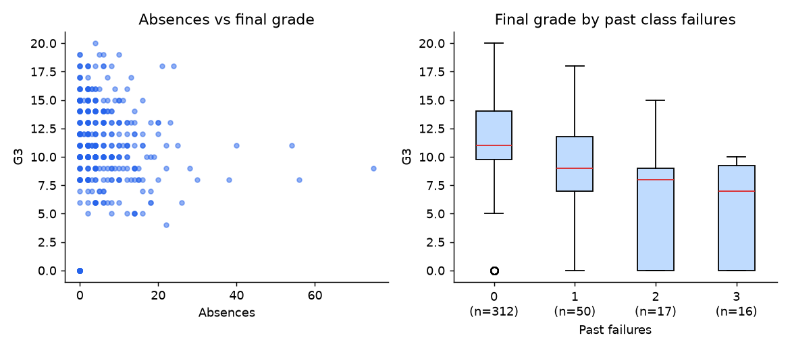
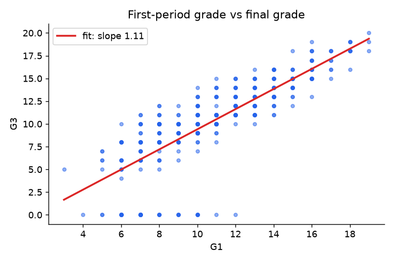

# Student Performance - Exploratory Data Analysis (Python)

An end-to-end analysis of a **real public dataset** using **pandas, NumPy and Matplotlib**: validate -> explore -> visualise -> model -> interpret.

**Data:** UCI *Student Performance* (maths course): 395 secondary-school students, 33 attributes (study time, past failures,
absences, family background, and three period grades G1/G2/G3 on a 0-20 scale).
Source: <https://archive.ics.uci.edu/dataset/320/student+performance> - licence **CC BY 4.0**.
Citation: P. Cortez and A. Silva, *Using Data Mining to Predict Secondary School Student Performance*, FUBUTEC 2008.
The original data and its attribute description are in `data/` unchanged.

## Question
What is associated with a student's final maths grade (G3), and how well can it be predicted?

## Method
1. **Validation:** shape, missing values, duplicates, and a check that every grade lies on the documented 0-20 scale.
2. **EDA:** grade distribution, study time, past failures, absences, correlation matrix.
3. **Modelling:** linear regression written with NumPy (`lstsq`) on standardised features, scored as the mean over
   200 random 80/20 train/test splits and compared with a "predict the mean" baseline. Three models:
   background/behaviour only, the same plus earlier grades (G1, G2), and the first model without grade-0 students.

## Findings (see `results.md` for all numbers)
| Finding | Evidence |
|---|---|
| Earlier grades dominate prediction | Test R^2 0.08 without G1/G2 -> 0.82 with them; RMSE 4.29 -> 1.92 grade points |
| Past failures: clearest negative association | r = -0.36 with G3 |
| More weekly study time: modest positive association | r = 0.10; mean G3 10.0 (<2 h) vs 11.3 (>10 h, only 27 students) |
| A data-quality issue hides a pattern | All 38 students with G3 = 0 have 0 recorded absences; overall r(absences, G3) = 0.03, but -0.21 without them |

<p>
  
  
</p>
<p>
  
  
</p>

## Limits
One maths course, 395 students from two schools, observational data: the results show associations, not causes.
The explanation for the grade-0 students is my inference, not something stated in the dataset documentation.

## Run it
```bash
pip install -r requirements.txt
python eda.py        # writes images/ and results.md
```

## Files
| File | Purpose |
|---|---|
| `eda.py` | Validation, EDA, plots, regression, auto-written report |
| `data/student-mat.csv` | UCI dataset (semicolon-separated) |
| `data/student.txt` | Original attribute description |
| `images/` | Charts produced by `eda.py` |
| `results.md` | Auto-generated results |

## Next steps
- Add the Portuguese-language course file and compare subjects
- Cross-validation with regularised and tree-based models; classification of pass/fail
- Turn the analysis into a notebook with written commentary
