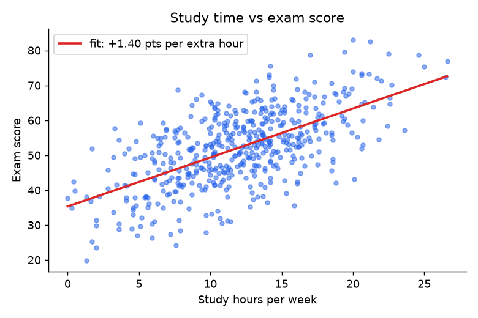
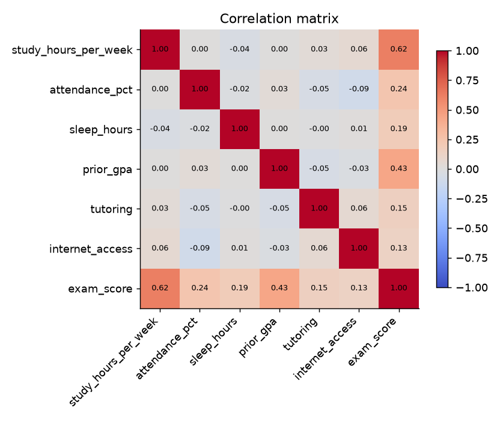
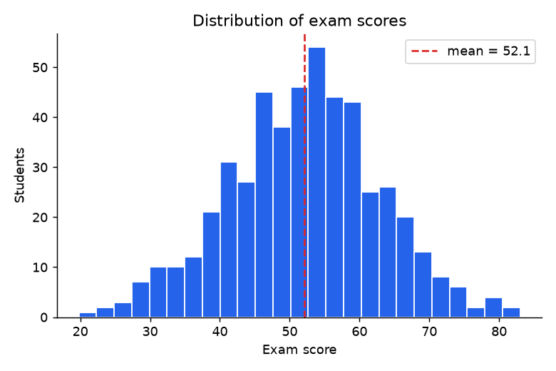
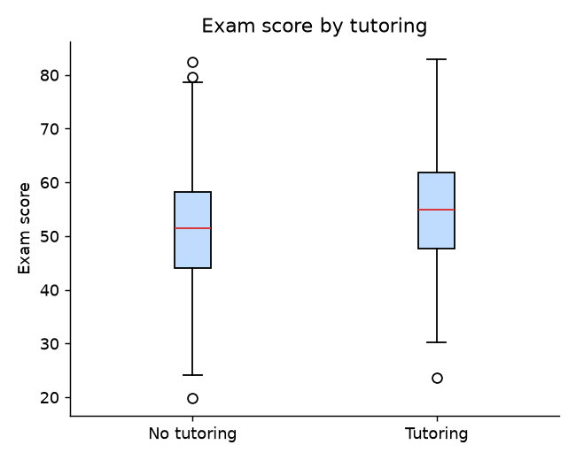

# Student Performance - Exploratory Data Analysis (Python)

An end-to-end analysis workflow in Python with **pandas, NumPy and Matplotlib**: load -> clean -> explore -> visualise -> model.

> **Important:** the dataset is **synthetic**. `generate_data.py` simulates 500 students with built-in
> assumptions (e.g. more study time raises scores) and deliberately injects missing values and duplicate rows.
> The project demonstrates the *analysis workflow*, not real-world findings.

## What it does
1. **Data cleaning**: removes duplicate students, fills missing values with the column median, asserts no gaps remain.
2. **EDA**: summary statistics, correlation matrix, distributions, group comparison (tutoring vs. none).
3. **Modelling**: multiple linear regression written with NumPy (`lstsq`) on standardised features, evaluated on a
   held-out 20% test set (R^2 and RMSE) - no black-box library, so each step is visible.
4. Saves charts to `images/` and a written report to `results.md`.

## Results (from `results.md`)
| Metric | Value |
|---|---|
| Rows (raw -> clean) | 505 -> 500 |
| Strongest correlation with exam score | study hours per week (r = 0.62) |
| Test R^2 / RMSE | 0.64 / 6.1 points |
| Simple fit | +1.40 points per extra weekly study hour |

<p>
  
  
</p>
<p>
  
  
</p>

## Run it
```bash
pip install -r requirements.txt
python generate_data.py   # creates data/students.csv (seeded, reproducible)
python eda.py             # writes images/ and results.md
```

## Files
| File | Purpose |
|---|---|
| `generate_data.py` | Seeded synthetic data generator (reproducible) |
| `eda.py` | Cleaning, EDA, plots, regression, report |
| `data/students.csv` | Generated dataset |
| `images/` | Charts produced by `eda.py` |
| `results.md` | Auto-generated results |

## What I'd do next
- Replace the synthetic data with a real public dataset (e.g. from Kaggle or the UCI repository)
- Add cross-validation and compare with regularised / tree-based models
- Turn the analysis into a Jupyter notebook with narrative explanations
